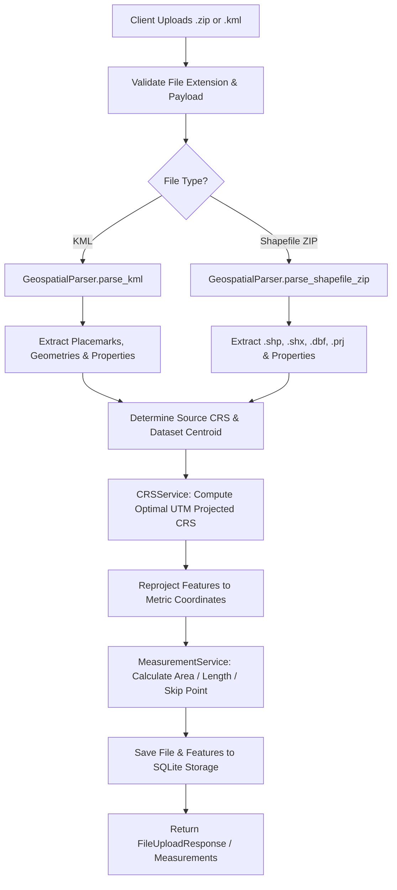

# Geospatial File Measurement API

A production-grade backend service built with **FastAPI**, **Shapely**, **PyProj**, and **PyShp** that accepts geospatial files (ESRI Shapefiles in `.zip` format and Keyhole Markup Language `.kml` files), extracts vector features, reprojects geographic coordinates to appropriate projected coordinate reference systems (UTM), and computes metric measurements (Polygon Area, LineString Length, and graceful Point handling).

---

## Table of Contents
1. [Overview & Features](#overview--features)
2. [Setup & Installation](#setup--installation)
3. [Running the Application](#running-the-application)
4. [API Documentation](#api-documentation)
   - [1. Upload Geospatial File (`POST /api/files/`)](#1-upload-geospatial-file-post-apifiles)
   - [2. Get File Information (`GET /api/files/{id}/`)](#2-get-file-information-get-apifilesid)
   - [3. Get Feature Measurements (`GET /api/files/{id}/measurements/`)](#3-get-feature-measurements-get-apifilesidmeasurements)
   - [4. List All Files (`GET /api/files/`)](#4-list-all-files-get-apifiles)
   - [5. Delete File (`DELETE /api/files/{id}/`)](#5-delete-file-delete-apifilesid)
   - [6. Health Check (`GET /api/health/`)](#6-health-check-get-apihealth)
5. [Interactive Web Dashboard & OpenAPI UI](#interactive-web-dashboard--openapi-ui)
6. [Architecture](#architecture)
   - [Application Structure](#application-structure)
   - [File-Processing Flow](#file-processing-flow)
   - [Measurement Calculation Flow](#measurement-calculation-flow)
   - [CRS Handling & Projection Strategy](#crs-handling--projection-strategy)
7. [Design Decisions & Alternatives](#design-decisions--alternatives)
8. [Testing & Verification](#testing--verification)
9. [Learnings & Future Scope](#learnings--future-scope)

---

## Overview & Features

- **Multi-Format Ingestion**: Supports `.zip` containing Shapefile components (`.shp`, `.shx`, `.dbf`, `.prj`) and `.kml` XML files.
- **Robust Feature Extraction**: Extracts Feature ID/index, Geometry Type, GeoJSON-compatible Geometry coordinates, Source CRS, and Attribute Properties (from DBF or KML ExtendedData/SimpleData).
- **Correct Metric CRS Reprojection**: Adheres to the requirement of **never computing area or distance directly on angular degrees** (EPSG:4326). Dynamically projects geometries to the optimal local **Universal Transverse Mercator (UTM)** zone or uses native projected coordinates.
- **Accurate Metric Measurements**:
  - **Polygon / MultiPolygon**: Area in square meters ($m^2$), hectares ($ha$), and square kilometers ($km^2$), along with boundary perimeter ($m$).
  - **LineString / MultiLineString**: Length in meters ($m$) and kilometers ($km$).
  - **Point / MultiPoint**: Gracefully handled with no measurement required ($0$-dimensional points).
  - **Unsupported / Empty Geometries**: Gracefully skipped without crashes or uncaught exceptions.
- **Thread-Safe Persistent Storage**: Lightweight, reliable SQLite database storing file metadata, features, and measurements.
- **Interactive UI & Swagger Docs**: Bundled dark-mode web dashboard at `/` and interactive OpenAPI documentation at `/docs` and `/redoc`.

---

## Setup & Installation

### Prerequisites
- Python **3.10+** (tested on Python 3.12)
- Git

### 1. Clone the Repository
```bash
git clone <YOUR_GITHUB_REPO_URL>
cd aereo
```

### 2. Create and Activate a Virtual Environment
```bash
# Windows (PowerShell)
python -m venv venv
.\venv\Scripts\Activate.ps1

# Linux / macOS
python3 -m venv venv
source venv/bin/activate
```

### 3. Install Dependencies
```bash
pip install -r requirements.txt
```

---

## Running the Application

### Start the FastAPI Dev Server
```bash
uvicorn app.main:app --reload --host 0.0.0.0 --port 8000
```
Once started, access:
- **Interactive Web UI**: [http://localhost:8000/](http://localhost:8000/)
- **Swagger / OpenAPI Documentation**: [http://localhost:8000/docs](http://localhost:8000/docs)
- **ReDoc Documentation**: [http://localhost:8000/redoc](http://localhost:8000/redoc)

### Generate Sample Test Files
Pre-built sample datasets are included in `sample_data/`. You can regenerate them anytime:
```bash
python scripts/generate_sample_data.py
```
This generates:
- `sample_data/sample_drone_survey.kml`: Real KML mission containing Polygons, LineStrings, and Point base stations.
- `sample_data/sample_parcels_shapefile.zip`: Shapefile archive with cadastral polygons and `.prj`.
- `sample_data/sample_flight_lines_shapefile.zip`: Shapefile archive with flight lines.

---

## API Documentation

### 1. Upload Geospatial File (`POST /api/files/`)
Uploads and parses a `.zip` Shapefile or `.kml` file, reprojects coordinates, calculates measurements, and stores results.

**Request:**
- **Method**: `POST`
- **Path**: `/api/files/`
- **Content-Type**: `multipart/form-data`
- **Body**: `file` (binary file upload)

**Example with cURL:**
```bash
curl -X POST "http://localhost:8000/api/files/" \
  -H "accept: application/json" \
  -H "Content-Type: multipart/form-data" \
  -F "file=@sample_data/sample_drone_survey.kml"
```

**Example Response (`201 Created`):**
```json
{
  "id": "d069fd728027",
  "filename": "sample_drone_survey.kml",
  "feature_count": 6,
  "crs": "EPSG:4326",
  "status": "COMPLETED",
  "projected_crs": "EPSG:32643",
  "created_at": "2026-10-08T07:27:49.123456+00:00"
}
```

---

### 2. Get File Information (`GET /api/files/{id}/`)
Retrieves high-level metadata, feature count, detected CRS, and processing status.

**Request:**
- **Method**: `GET`
- **Path**: `/api/files/{id}/`

**Example with cURL:**
```bash
curl -X GET "http://localhost:8000/api/files/d069fd728027/"
```

**Example Response (`200 OK`):**
```json
{
  "id": "d069fd728027",
  "filename": "sample_drone_survey.kml",
  "feature_count": 6,
  "crs": "EPSG:4326",
  "status": "COMPLETED",
  "projected_crs": "EPSG:32643",
  "created_at": "2026-10-08T07:27:49.123456+00:00"
}
```

---

### 3. Get Feature Measurements (`GET /api/files/{id}/measurements/`)
Returns feature-by-feature geometric measurements (Polygon Area, LineString Length, Point skipped) along with dataset summary totals.

**Request:**
- **Method**: `GET`
- **Path**: `/api/files/{id}/measurements/`

**Example with cURL:**
```bash
curl -X GET "http://localhost:8000/api/files/d069fd728027/measurements/"
```

**Example Response (`200 OK`):**
```json
{
  "id": "d069fd728027",
  "filename": "sample_drone_survey.kml",
  "crs": "EPSG:4326",
  "projected_crs": "EPSG:32643",
  "status": "COMPLETED",
  "feature_count": 6,
  "features": [
    {
      "feature_index": 0,
      "feature_id": "Survey Zone Alpha (Field)",
      "geometry_type": "Polygon",
      "geometry": {
        "type": "Polygon",
        "coordinates": [
          [[77.59, 12.97], [77.60, 12.97], [77.60, 12.98], [77.59, 12.98], [77.59, 12.97]]
        ]
      },
      "crs": "EPSG:4326",
      "projected_crs": "EPSG:32643",
      "properties": {
        "name": "Survey Zone Alpha (Field)",
        "description": "High-resolution multispectral mapping zone",
        "crop_type": "Wheat",
        "target_gsd_cm": "2.5"
      },
      "measurement": {
        "type": "area",
        "value": 1201683.92,
        "unit": "sq_meters",
        "formatted": "1,201,683.92 m² (120.17 ha)",
        "details": {
          "area_sq_meters": 1201683.92,
          "area_hectares": 120.1684,
          "area_sq_km": 1.201684,
          "perimeter_meters": 4385.06
        }
      }
    },
    {
      "feature_index": 2,
      "feature_id": "Linear Pipeline Corridor",
      "geometry_type": "LineString",
      "geometry": {
        "type": "LineString",
        "coordinates": [
          [77.585, 12.965], [77.592, 12.971], [77.598, 12.979], [77.605, 12.985]
        ]
      },
      "crs": "EPSG:4326",
      "projected_crs": "EPSG:32643",
      "properties": {
        "name": "Linear Pipeline Corridor",
        "voltage_kv": "66"
      },
      "measurement": {
        "type": "length",
        "value": 3117.8,
        "unit": "meters",
        "formatted": "3,117.80 m (3.118 km)",
        "details": {
          "length_meters": 3117.8,
          "length_km": 3.1178
        }
      }
    },
    {
      "feature_index": 4,
      "feature_id": "Drone Takeoff Pad LZ-1",
      "geometry_type": "Point",
      "geometry": {
        "type": "Point",
        "coordinates": [77.5946, 12.9716]
      },
      "crs": "EPSG:4326",
      "projected_crs": "EPSG:32643",
      "properties": {
        "name": "Drone Takeoff Pad LZ-1"
      },
      "measurement": {
        "type": "none",
        "value": null,
        "unit": null,
        "formatted": "No measurement required for Point",
        "details": {
          "note": "Points represent dimensionless zero-area coordinates; no measurement required."
        }
      }
    }
  ],
  "summary": {
    "total_features": 6,
    "polygon_count": 2,
    "linestring_count": 2,
    "point_count": 2,
    "unsupported_count": 0,
    "total_area_sq_meters": 1706401.49,
    "total_area_hectares": 170.6401,
    "total_length_meters": 4214.1,
    "total_length_km": 4.2141
  }
}
```

---

### 4. List All Files (`GET /api/files/`)
Returns a list of all processed files ordered by creation date descending.

### 5. Delete File (`DELETE /api/files/{id}/`)
Deletes a file, its features, and stored measurements.

### 6. Health Check (`GET /api/health/`)
Service heartbeat endpoint returning `{"status": "healthy"}`.

---

## Interactive Web Dashboard & OpenAPI UI

When running the application, opening `http://localhost:8000/` displays a modern visual dashboard:
1. **Drag-and-Drop Uploader**: Upload any `.kml` or `.zip` directly in your browser.
2. **Instant Sample Buttons**: One-click test with preloaded Drone Missions, Parcels, or Flight Lines.
3. **Stat Cards & Metrics**: Dynamic overview of total area ($m^2$ and $ha$), total length ($m$ and $km$), feature breakdown, and selected projected UTM CRS.
4. **Interactive Feature Table**: Inspect each feature's geometry type, attributes, and metric measurements.

---

## Architecture

### Application Structure
```
aereo/
├── app/
│   ├── __init__.py
│   ├── main.py                     # FastAPI app initialization, middleware, routes, lifespan
│   ├── config.py                   # App configuration, directories, allowed extensions
│   ├── models/
│   │   ├── __init__.py
│   │   └── schemas.py              # Pydantic v2 validation schemas
│   ├── services/
│   │   ├── __init__.py
│   │   ├── crs_service.py          # CRS parsing, UTM zone calculation, geometry reprojection
│   │   ├── parser.py               # Shapefile (.zip) and KML parsers
│   │   ├── measurement.py          # Metric area/length calculation & Point handling
│   │   ├── processor.py            # Coordination workflow from upload to persistence
│   │   └── storage.py              # Thread-safe SQLite persistence layer
│   ├── api/
│   │   ├── __init__.py
│   │   └── routes.py               # REST API endpoints
│   └── static/
│       └── index.html              # Interactive dark-themed web dashboard
├── tests/
│   ├── __init__.py
│   ├── conftest.py                 # Pytest fixtures and isolated test environment
│   ├── test_api.py                 # Integration tests for all API endpoints
│   ├── test_crs.py                 # Unit tests for UTM selection and reprojection
│   └── test_measurements.py        # Unit tests for geometric calculations and edge cases
├── sample_data/                    # Sample KML and Shapefile .zip datasets
├── scripts/
│   └── generate_sample_data.py     # Reproducible sample data generator
├── requirements.txt                # Production dependencies
├── pytest.ini                      # Pytest configuration
├── .gitignore                      # Git ignore patterns
└── README.md                       # Complete documentation
```

### File-Processing Flow


### Measurement Calculation Flow
1. **Geometry Extraction**: Shapely geometries are constructed from parsed GeoJSON coordinates.
2. **Dimension Check**:
   - Polygons (2D surface) $\rightarrow$ Calculate Area ($m^2$) and Perimeter ($m$).
   - LineStrings (1D curve) $\rightarrow$ Calculate Length ($m$).
   - Points (0D point) $\rightarrow$ Skipped cleanly (`measurement: null`, note indicating zero dimension).
   - Unsupported / Empty $\rightarrow$ Handled gracefully without failure.
3. **Reprojection**: The geometry is transformed into linear meters using `pyproj.Transformer` with `always_xy=True`.
4. **SI Unit Formatting**: Raw values in meters and square meters are rounded and accompanied by secondary units (hectares, square kilometers, kilometers).

### CRS Handling & Projection Strategy

#### The Angular Distortion Problem
Geographic coordinates (such as **WGS84 / EPSG:4326**) represent positions on an oblate spheroid in angular degrees ($\text{longitude}^\circ, \text{latitude}^\circ$). Calculating Euclidean distances or polygon areas directly on degree coordinates causes severe distortions:
- $1^\circ$ of latitude is $\approx 111\text{ km}$, but $1^\circ$ of longitude scales with $\cos(\text{latitude})$, shrinking to $0\text{ km}$ at the poles.
- Calculating $\Delta x \times \Delta y$ in degrees produces meaningless "square degrees" rather than square meters.

#### Our Dynamic UTM Projection Strategy
To achieve conformal, metric-accurate measurements:
1. **Centroid Determination**: The centroid $(\text{lon}, \text{lat})$ of the geometry or dataset is determined.
2. **Optimal UTM Zone Calculation**:
   $$\text{Zone} = \left\lfloor \frac{\text{longitude} + 180}{6} \right\rfloor + 1 \quad (1 \le \text{Zone} \le 60)$$
   $$\text{EPSG Code} = \begin{cases} 32600 + \text{Zone} & \text{if } \text{latitude} \ge 0^\circ \text{ (Northern Hemisphere)} \\ 32700 + \text{Zone} & \text{if } \text{latitude} < 0^\circ \text{ (Southern Hemisphere)} \end{cases}$$
3. **Polar Latitude Fallback**: For extreme latitudes ($> 84^\circ\text{N}$ or $<-80^\circ\text{S}$), Universal Polar Stereographic (UPS North `EPSG:32661` or UPS South `EPSG:32761`) is applied.
4. **Coordinate Transformation**: `pyproj.Transformer.from_crs(source_crs, target_crs, always_xy=True)` reprojects all coordinate tuples into metric UTM coordinates where units are strictly in **meters**.

---

## Design Decisions & Alternatives

| Decision | Selected Approach | Alternative Considered | Rationale |
| :--- | :--- | :--- | :--- |
| **Framework** | **FastAPI** | Django / Flask | FastAPI provides native asynchronous request handling, automatic OpenAPI/Swagger documentation, and Pydantic v2 data validation with near-zero overhead. |
| **KML Parser** | **`xml.etree.ElementTree` Standard Parser** | `fastkml` or external binaries | Zero binary build issues on diverse platforms; resilient against non-standard KML namespaces, custom placemark schemas, and 3D coordinate strings. |
| **Shapefile Handler** | **`pyshp` (`shapefile.Reader`)** | `GDAL` / `Fiona` / `GeoPandas` | Native Python package with zero C++ compilation or GDAL shared library requirements, ensuring painless deployment on Windows, macOS, and Linux containers. |
| **CRS Transformation** | **`pyproj` + Dynamic UTM Selection** | EPSG:3857 (Web Mercator) | Web Mercator (EPSG:3857) introduces severe scale distortion away from the equator (up to 400%+ area error at high latitudes). Local UTM zones keep scale distortion below 0.1%. |
| **Persistence** | **SQLite via Thread-Safe Handler** | PostgreSQL / PostGIS | Completely self-contained; runs instantly without requiring an external database cluster setup for reviewers while maintaining relational integrity. |

---

## Testing & Verification

The project includes an automated **17-test suite** covering unit and integration scenarios:
- Health check and dashboard serving
- File upload for KML and Shapefile `.zip`
- Correct extraction and calculation of Polygon area, LineString length, and Point exclusion
- Unsupported file extension and corrupted zip rejection
- Non-existent file 404 responses
- Global UTM zone determination across Bangalore, London, Sydney, Rio de Janeiro, and poles
- Coordinate reprojection accuracy verification

### Run the Test Suite
```bash
python -m pytest -v
```
**Expected Output:**
```
============================= test session starts =============================
collected 17 items

tests/test_api.py::test_health_check PASSED                              [  5%]
tests/test_api.py::test_dashboard_endpoint PASSED                        [ 11%]
tests/test_api.py::test_sample_file_download PASSED                      [ 17%]
tests/test_api.py::test_upload_kml_file PASSED                           [ 23%]
tests/test_api.py::test_upload_shapefile_zip PASSED                      [ 29%]
tests/test_api.py::test_invalid_extension PASSED                         [ 35%]
tests/test_api.py::test_corrupted_zip PASSED                             [ 41%]
tests/test_api.py::test_file_not_found PASSED                            [ 47%]
tests/test_api.py::test_list_and_delete_file PASSED                      [ 52%]
tests/test_crs.py::test_utm_zone_determination PASSED                    [ 58%]
tests/test_crs.py::test_crs_parsing PASSED                               [ 64%]
tests/test_crs.py::test_geometry_reprojection PASSED                     [ 70%]
tests/test_measurements.py::test_polygon_area_calculation PASSED         [ 76%]
tests/test_measurements.py::test_linestring_length_calculation PASSED    [ 82%]
tests/test_measurements.py::test_point_handling_no_measurement PASSED    [ 88%]
tests/test_measurements.py::test_empty_geometry_graceful PASSED          [ 94%]
tests/test_measurements.py::test_geometry_collection_graceful PASSED     [100%]

============================= 17 passed in 0.53s ==============================
```

---

## Learnings & Future Scope

### Learnings
1. **Geodesic vs. Conformal Planar Projections**: While UTM projection yields fast, conformal Cartesian geometry calculations with under 0.1% scale distortion inside a zone, features that span across multiple UTM zones can benefit from Geodesic ellipsoidal calculations (`pyproj.Geod(ellps="WGS84")`) or custom Equal-Area projections (e.g., Albers Equal Area).
2. **Shapefile Format Heterogeneity**: A single `.shp` file strictly allows only one geometry type (e.g. only Polygons or only LineStrings), whereas a single KML file allows mixed geometry placemarks. Packaging multi-layer shapefiles in `.zip` archives requires aggregating distinct layer files seamlessly.
3. **KML Namespace Variations**: KML documents in the wild often use varied XML namespaces (`http://www.opengis.net/kml/2.2`, `http://earth.google.com/kml/2.1`, or no namespace). Using local-name wildcard matching (`{*}tag`) ensures universal parsing without fragile namespace hardcoding.

### Future Scope
1. **PostGIS Backend Integration**: Support PostgreSQL + PostGIS with `ST_Transform`, `ST_Area`, and `ST_Length` for enterprise spatial querying.
2. **GeoTIFF / Raster Support**: Extend measurements to raster datasets (Digital Elevation Models, Orthomosaics) for volume calculation and surface cut-and-fill analysis.
3. **Asynchronous Background Processing for Large Files**: Integrate Celery or Redis Queue for processing multi-gigabyte survey shapefiles containing hundreds of thousands of vertices.
4. **Cloud Storage Integration**: Store raw survey files in AWS S3 or Google Cloud Storage with presigned URLs.
